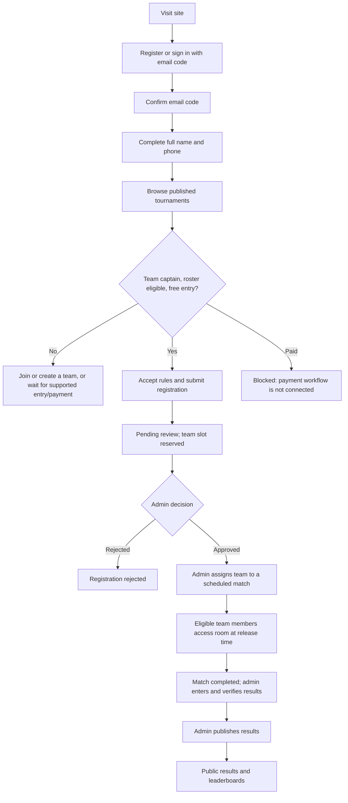

# Member Tournament Workflow

This describes the workflow implemented by the checked-in React pages and Supabase migrations. It is not a claim that migrations have been applied to a live project.

## Current member journey

### 1. Authentication and profile

Members request a one-time email code through Supabase Auth. Registration requests user creation; login does not. Code verification creates the Supabase session. Email delivery and confirmation depend on the project’s Email provider, SMTP, and template configuration; see [AUTHENTICATION_SETUP.md](AUTHENTICATION_SETUP.md).

After signup, the UI directs the member to complete a full name and phone number. Profile completion is checked server-side by `rs_internal.is_player_ready()` in the profile-hardening migration, including `auth.users.email_confirmed_at`. The account page allows full-name and phone edits through `public.update_my_contact_profile`, added in `20261113150000_member_contact_profile.sql`. That migration must be applied before this edit path works. Email changes are requested through Supabase `auth.updateUser` and do not become the authenticated email until Supabase confirms the change.

### 2. Tournament discovery and eligibility

The tournament arena and detail page read published tournament data. Details show the game/mode/format, fee, team capacity, registration close, start time, timezone, schedule, rules, and eligibility text.

The implemented registration UI is team-based. A captain submits a registration for a team. The UI currently permits only free tournaments and checks the active starting roster, substitute rules, available slots, registration window, and an existing active registration. The `register_team_for_tournament` RPC is the trusted boundary and repeats the important eligibility and capacity checks. Pending and approved registrations reserve capacity; duplicate active team entries are rejected.

Individual registration is not available in the tournament UI. Tournament detail pages can describe paid events, but paid registration is blocked because payment submission and verification are not integrated into this flow. The UI explicitly reports that payment verification is unsupported.

### 3. Review, scheduling, and room access

A submitted free registration is pending review. Admins can inspect the registration, team roster, and history, then approve, reject, or disqualify it. Rejection/disqualification requires a reason. The database RPC checks administrator authority and valid state transitions.

Admins create tournament matches, assign approved teams subject to lobby capacity, and configure room credentials separately. Members retrieve room credentials through `get_match_room_credentials`; the database controls team membership, assignment, room readiness, and release time. Admin-only room retrieval is separate. This access path has not been exercised against a live database in this audit.

### 4. Results and leaderboards

Admins configure scoring, enter result drafts, submit them for review, verify or dispute them, and publish results. Points are calculated in the database, not trusted from the preview in the browser. Corrections to published results require a reason and a separate verification before republishing. Public result and leaderboard views consume published results.

### Not implemented or unverified

- Paid tournament payment submission, payment reviewer queue, and payment-to-registration integration are not connected in the member UI.
- Standalone Quick Match creation and registration are explicitly not connected.
- Individual tournament registration is not present in the current member flow.
- No live signup, OTP delivery, database RPC, RLS, room release, or result workflow was exercised because this workspace has no configured Supabase project credentials.
- Database behavior is only as current as the migrations applied to the target project; no migration was pushed by this work.
